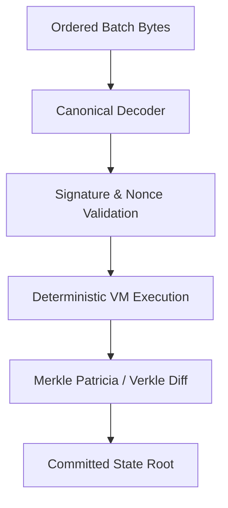

A blockchain execution client has one non-negotiable obligation: given the identical parent state root $S_{n-1}$ and ordered transaction batch $B_n$, every honest node—regardless of CPU architecture, operating system, or compiler patch level—must arrive at the exact same successor state root $S_n$.

<!-- more -->

In practice, determinism is rarely broken by obvious randomness like `Math.random()`. It fractures quietly through iteration order in hash maps, floating-point rounding drift, system clock reads, and subtle differences in memory exhaustion behavior.

## 1. Sources of Non-Determinism

1. **Map iteration order**: Default hash tables randomize bucket seeds per process to mitigate HashDoS attacks. Always sort keys canonically before hashing or encoding.
2. **Ambient environment leaks**: Locale-dependent string collation, timezone offsets, and filesystem ordering must never enter state transition logic.
3. **Gas & resource metering**: If out-of-memory conditions depend on host allocator fragmentation, two nodes can disagree on whether a complex transaction reverts or succeeds.

:::note{title="Execution Isolation"}
Treat the state transition function `applyBlock(parentState, block) -> nextState` as a pure mathematical function with zero ambient I/O. Every external input—including timestamps and block hashes—belongs inside the explicit block envelope.
:::

## 2. Canonical State Transition Pipeline



### Enforcing Canonical Encoding

```rust
use std::collections::BTreeMap;

pub struct StateDiff {
    /// BTreeMap guarantees lexicographical key order across platforms.
    pub updates: BTreeMap<[u8; 32], Vec<u8>>,
}

impl StateDiff {
    pub fn encode_canonical(&self) -> Vec<u8> {
        let mut out = Vec::new();
        for (key, value) in &self.updates {
            out.extend_from_slice(key);
            out.extend_from_slice(&(value.len() as u32).to_be_bytes());
            out.extend_from_slice(value);
        }
        out
    }
}
```

## 3. Proving Equivalence

When an optimistic or zero-knowledge rollup generates a proof over execution traces, the verifier checks that the state transition satisfies $f(S_{n-1}, B_n) = S_n$ under a fixed instruction set architecture. Keeping the execution kernel small, pure, and free of host assumptions makes both fault proofs and ZK circuits substantially cheaper to audit.
