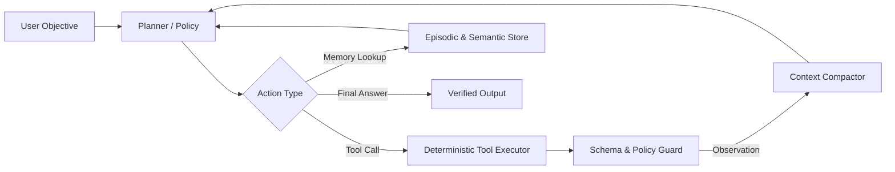

Modern language models rarely fail because they cannot write a coherent paragraph. They fail when a workflow requires **sustained state across twenty tool calls**, graceful recovery from partial failures, and strict adherence to domain constraints.

<!-- more -->

Over the past year, the gap between impressive demos and dependable production agents has narrowed down to a small set of architectural disciplines: explicit state transitions, layered memory, verifiable tool contracts, and disciplined context compaction.

:::note{title="Core Premise"}
An agent is not a prompt with a `while (true)` loop attached. It is a bounded control system where a probabilistic planner operates over deterministic tools, typed observations, and explicit stop conditions.
:::

## 1. Anatomy of an Agent Execution Loop

At its core, every capable agent alternates between **deliberation** (selecting the next action given current context) and **observation** (absorbing structured feedback from the outside world). When this loop is left unconstrained, token usage compounds quadratically while signal-to-noise ratio steadily degrades.



### Bounded Planning vs. Open-Ended Search

Rather than asking a model to invent an entire twenty-step plan upfront, production systems favor **receding-horizon planning**: plan two or three steps ahead, execute one verifiable step, observe the ground truth, and re-evaluate.

> Good agent architecture replaces speculative reasoning with cheap, deterministic checks. Whenever a compiler, schema validator, or unit test can answer a question, never spend reasoning tokens guessing.

## 2. Layered Memory Architecture

Context windows are working registers, not databases. Treating a 200k-token context window as an append-only dump leads to attention dilution—especially when stale tool outputs contradict newer observations.


| Memory Layer | Lifespan | Storage Backing | Primary Failure Mode | Mitigation |
| :--- | :--- | :--- | :--- | :--- |
| Working Context | Single run | In-prompt message window | Stale tool dumps & drift | Periodic structured summarization |
| Episodic Memory | Days to months | Indexed run traces / logs | Retrieving outdated failures | Time-decay & outcome weighting |
| Semantic Memory | Durable | Curated Markdown / vector store | Contradictory facts | Source provenance & version tags |
| Procedural Memory | Versioned | Typed tools & SOP templates | Silent schema breakage | Strict runtime contract tests |

### Formalizing Retrieval Utility

When choosing which memory fragments $m \in \mathcal{M}$ to inject into the active context budget $B$, naive cosine similarity alone tends to surface repetitive, redundant chunks. A practical scoring objective balances relevance, recency, and marginal novelty:

$$
U(m \mid q, S) = \alpha \cdot \text{sim}(q, m) + \beta \cdot e^{-\lambda \Delta t_m} - \gamma \cdot \max_{s \in S} \text{sim}(m, s)
$$

where $q$ is the current sub-goal embedding, $\Delta t_m$ is the age of memory item $m$, and $S$ is the set of fragments already selected within the token budget $\sum_{m \in S} |m| \le B$.

## 3. Designing Verifiable Tool Contracts

Tools should be designed like public APIs for a careful junior engineer: narrow surface area, explicit error taxonomy, and idempotency keys wherever side effects occur.

```typescript
export interface ToolExecutionResult<T> {
  ok: boolean;
  data?: T;
  error?: {
    code: 'INVALID_INPUT' | 'TRANSIENT_FAILURE' | 'POLICY_DENIED';
    message: string;
    retryable: boolean;
  };
  elapsedMs: number;
}

export async function runBoundedAgentStep<T>(
  toolName: string,
  payload: unknown,
  executor: (input: unknown) => Promise<T>,
  timeoutMs = 8_000
): Promise<ToolExecutionResult<T>> {
  const startedAt = performance.now();

  try {
    const data = await Promise.race([
      executor(payload),
      new Promise<never>((_, reject) =>
        setTimeout(() => reject(new Error(`Tool ${toolName} timed out`)), timeoutMs)
      ),
    ]);

    return { ok: true, data, elapsedMs: Math.round(performance.now() - startedAt) };
  } catch (err) {
    return {
      ok: false,
      error: {
        code: 'TRANSIENT_FAILURE',
        message: err instanceof Error ? err.message : 'Unknown execution failure',
        retryable: true,
      },
      elapsedMs: Math.round(performance.now() - startedAt),
    };
  }
}
```

:::tip{title="Return Actionable Errors"}
When a tool rejects malformed arguments, return a concise correction hint—such as the expected ISO date format or missing required field—instead of a raw stack trace. Models self-correct dramatically faster when error payloads are written for readers.
:::

### Idempotency and Guardrails

For mutating actions (creating pull requests, dispatching webhooks, updating records), separate **dry-run inspection** from **commit execution**:

```python
from dataclasses import dataclass

@dataclass(frozen=True)
class ActionPolicy:
    max_steps: int = 12
    max_retries_per_tool: int = 2
    require_confirmation_for_writes: bool = True

def can_execute(step_index: int, retry_count: int, policy: ActionPolicy) -> bool:
    if step_index >= policy.max_steps:
        return False
    return retry_count <= policy.max_retries_per_tool
```

:::warning{title="Watch for Silent Retry Loops"}
Without a per-tool retry ceiling and semantic loop detector, an agent that encounters a deterministic permission error can burn its entire step budget invoking the same failing endpoint with cosmetically tweaked arguments.
:::

## 4. Production Readiness Checklist

Before moving an agent workflow from local prototype to unattended execution, validate the following operational invariants:

- [x] Every tool declares a strict input schema and bounded execution timeout.
- [x] Context compaction preserves original user constraints verbatim.
- [x] Deterministic unit tests cover parsing, routing, and policy guards.
- [x] Tool responses truncate large binary or log payloads cleanly.
- [ ] Replay harness evaluates regressions across at least 50 recorded trajectories.

:::details{title="Implementation Note: Trajectory Replay Format"}
Store every run as an append-only JSON Lines trace containing `{ step, promptHash, toolName, arguments, observationSummary, latencyMs, tokenUsage }`. Keeping traces human-readable makes diffing prompt or model upgrades straightforward during code review.
:::

## 5. Bilingual Summary · 中文摘要

现代 AI Agent 系统的可靠性并不取决于把所有历史塞进更大的上下文窗口，而在于建立清晰的**状态边界、分层记忆与可验证的工具契约**。当推理层只负责在受控预算内做决策，而把校验、重试与回放交给确定性工程基础设施时，Agent 才能真正从演示走向生产。
